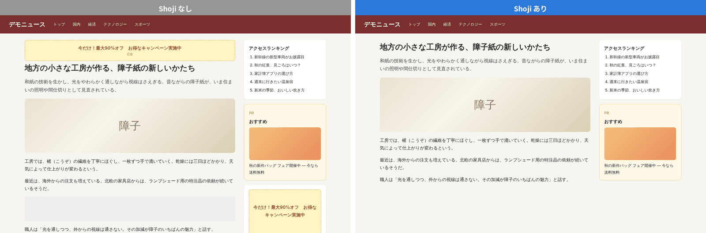
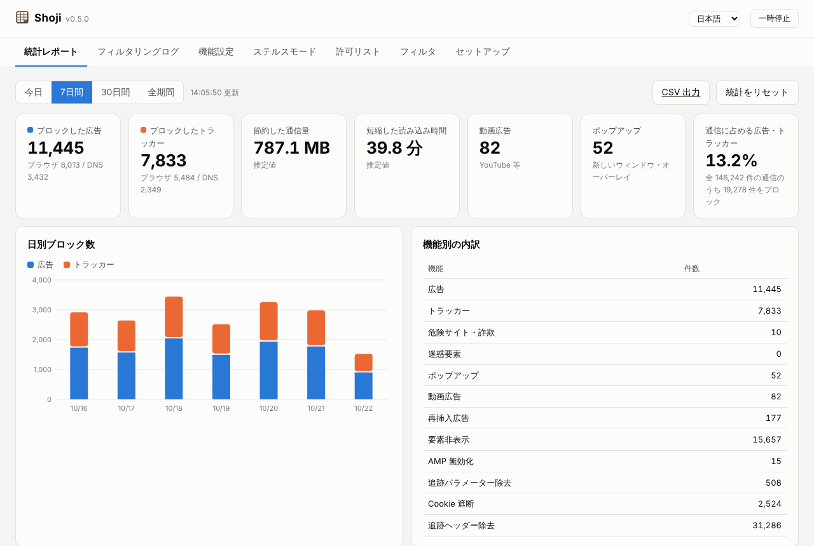
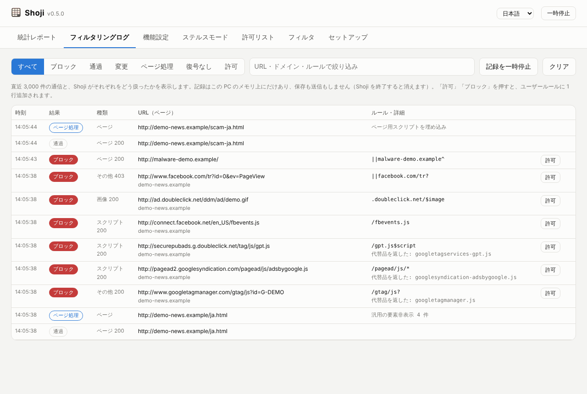
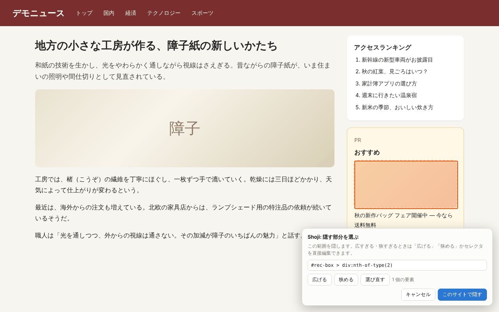
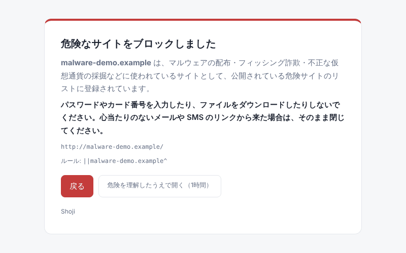
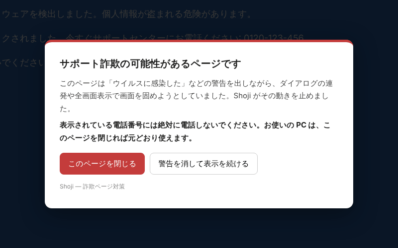

<p align="center">
  
</p>

<h1 align="center">Shoji（障子）</h1>

<p align="center">
  <b>Windows 用のローカル広告・トラッカー・プライバシーフィルタ</b><br>
  障子のように、光は通して、外からの視線は遮る。
</p>

<p align="center"><a href="README.md">English</a></p>

---

Shoji は、あなたの PC の中で **HTTPS フィルタリングプロキシ**・**DNS フィルタ**・**ダッシュボード** として動きます。
すべてのブラウザと、システムのプロキシ設定に従うアプリの広告とトラッカーを止めます。
YouTube の動画広告を取り除き、アクセス解析があなたを追いかけるための情報も送らないようにします。
処理はすべて PC の中で完結します。Shoji 用のサーバーはそもそも存在しないので、外部にデータを送ることもありません。

<p align="center"></p>

> **状態:** 初期リリース（0.x）です。Windows 11 + Microsoft Edge で日常的に使っていますが、粗い部分もあります。
> 不具合を見つけたら [Issue](../../issues) で教えてください。

## 機能

| 機能 | 内容 |
|---|---|
| ブラウザ広告をブロック | EasyList・AdGuard（日本語フィルタ含む）・uBlock Origin のフィルタなど約 65 万ルールで、広告の通信そのものを止めます |
| 動画広告（YouTube 等） | YouTube のプレイヤー応答から広告スケジュールを除去し、フィード・検索結果の広告カードも除去します。すり抜けた広告は自動でスキップします |
| X の広告ツイート | X（旧 Twitter）のタイムライン・返信・検索に混ざる広告ツイート（プロモーション）を取り除きます。表示が「広告」でも「Promoted」でも消せます |
| トラッカーをブロック | URL と DNS の両方で遮断します。CNAME で偽装したトラッカーも検出します |
| アプリ内広告をブロック | 内蔵 DNS サーバー（上流は DNS-over-HTTPS）で、すべてのアプリの広告ドメインを止めます。LAN 内のスマホにも使えます |
| 広告削除後のスペース調整 | 広告枠を隠したあと、残った空白や「広告」ラベルだけの枠を畳みます |
| ページ内スクリプトの調整 | uBlock Origin 形式の `##+js(...)` ルール（標準のリストで約 3,000 件）を実行し、広告ブロック検出や広告用スクリプトを止めます。主要な約 30 種類に対応（Shoji 独自の実装） |
| 拡張 CSS | CSS だけでは書けないサイト別のルール（`:has-text()`、`:upward()`、`:xpath()`、`:matches-css()`、`:remove()`、`:style()` など）と、AdGuard の `#?#` / `#$#`、Adblock Plus の `:-abp-has()` 形式に対応（標準のリストで約 2,000 件） |
| スクリプトの代替品 | 広告・計測のスクリプトをブロックしたとき、何もしない代替品を返します（`$redirect`）。Google アナリティクス、タグマネージャー、AdSense、GPT、動画広告の IMA SDK を呼ぶページが壊れにくくなります（Shoji 独自の実装） |
| 再挿入された広告をブロック | スクリプトで後から差し込まれた広告や、無理やり再表示された広告を除去します |
| ポップアップの非表示化 | クリックなしで開くウィンドウ、ポップアンダー、透明なクリック横取り広告を止めます |
| アフィリエイトバナーの非表示 | サイトが自分で貼った Amazon・楽天等の宣伝バナー画像も隠せます（設定でオフにできます） |
| ステルスモード | 追跡パラメーター除去、検索クエリの秘匿、リファラー最小化、トラッカー Cookie 遮断、DNT/GPC 送信、OS・機種情報（Client Hints）除去、WebRTC の IP 漏えい防止、画面・ハード情報・Canvas によるフィンガープリント妨害 |
| AMP の無効化 | Google AMP のページを元サイトの通常ページで開きます |
| 危険なサイト・詐欺ページ対策 | マルウェア配布・フィッシング・不正な採掘のサイトを警告画面で止めます（URLhaus・フィッシング・NoCoin のリスト）。「ウイルスに感染」などと表示し、警告の連発や全画面表示で画面を固めるサポート詐欺のページも無力化します |
| ClickFix 対策 | 偽の「ロボットではありません」確認などで、危険なコマンド（PowerShell・mshta など）をこっそりコピーさせ、「ファイル名を指定して実行」に貼り付けさせる手口を止めます。クリップボードには無害な注意書きが入ります |
| そっくりドメインの警告 | `аpple.com`（「а」はキリル文字）や `paypa1.com` のような、有名なサイトに見た目を似せたドメインを開く前に警告します。日本の銀行・カード・携帯会社・宅配便などを含む約 120 のサイトが対象です |
| 危険な種類のファイルの確認 | 開くとすぐにプログラムとして動く種類のファイル（.hta・.js・.vbs・.lnk・.scr・.bat・.ps1 など）は、ダウンロードの前に確認画面を出します |
| 通知の許可の要求を止める | ページを開いただけで出る「通知を許可しますか？」を止めます。偽のウイルス警告を出し続ける詐欺の入口です |
| ブラウザの更新の確認 | 使っている Edge・Chrome・Firefox が最新版より古いままなら知らせます。ページを開くだけで攻撃される種類の脆弱性への、いちばんの対策です |
| アプリごとの通信 | Shoji を経由したアプリごとに、どのサーバーと通信し、何がブロックされたかを表示します（記録はメモリ上だけ） |
| 迷惑要素の非表示 | Cookie の同意バナー、ページ内ポップアップ、チャットなどのウィジェット、アプリ誘導バナー、SNS ボタンを隠す AdGuard のリストを選んで使えます（初期状態はオフ） |
| 要素の選択ブロック | ページ上で `Ctrl`+`Shift`+`Alt`+`H` を押し、消したい部分をクリックするだけで「このサイトで隠す」ルールを保存します |
| このサイトでは止める | 表示が崩れたサイトでは `Ctrl`+`Shift`+`Alt`+`P` で、1 時間または常に Shoji を止められます。ダッシュボードの「許可リスト」から、最近開いたサイトをワンクリックで許可することもできます |
| フィルタリングログ | 直近の通信と、Shoji がそれぞれをどう扱ったか（ブロック・通過・変更・復号なし・ページ処理）を一致したルールとともに表示。「許可」「ブロック」ボタンでユーザールールを 1 行追加できます。記録はメモリ上だけで保存しません |
| 日本語 / 英語 | 画面はすべて日本語と英語に対応。初期設定では Windows の表示言語に合わせます |
| 統計レポート | 広告・トラッカー・ポップアップ・動画広告のブロック数、節約した通信量と短縮時間の推定、上位ドメイン、グラフ、CSV 出力 |

## 画面

<table>
<tr>
<td width="50%" valign="top"><br><sub><b>ダッシュボード</b> — ブロックした数や、節約できた通信量・時間の目安（見本のデータ）</sub></td>
<td width="50%" valign="top"><br><sub><b>フィルタリングログ</b> — 通信ごとの処理と一致したルール。「許可」「ブロック」もワンクリック</sub></td>
</tr>
<tr>
<td valign="top"><br><sub><b>要素の選択ブロック</b> — <kbd>Ctrl</kbd>+<kbd>Shift</kbd>+<kbd>Alt</kbd>+<kbd>H</kbd> で、消したい部分をクリック</sub></td>
<td valign="top"><br><br><br><sub><b>危険サイト・詐欺ページ対策</b> — マルウェアやフィッシングのサイト、画面を固める詐欺ページで警告</sub></td>
</tr>
</table>

## インストール

### Windows アプリ版（おすすめ・Python 不要）

1. [最新リリース](../../releases/latest) から **`Shoji-<バージョン>-windows-x64.zip`** をダウンロードし、好きな場所に展開します。
2. **`Shoji.exe`** を実行すると、タスクトレイに障子のアイコンが出て、ダッシュボード（http://127.0.0.1:8765）が開きます。

まだコード署名をしていないため、初回は「Windows によって PC が保護されました」と表示されることがあります。
「詳細情報」→「実行」で起動できます。ダウンロードしたファイルは、リリースページの `.sha256` で改ざんがないか確認できます。

### ソースから（Windows 10/11、[Python 3.12 以上](https://www.python.org/downloads/)）

```bat
git clone https://github.com/ebipepe/shoji.git
cd shoji
install.bat
start.bat
```

`start.bat` はコンソール画面を出さずにタスクトレイで起動します。ログを見ながら動かすときは `start_console.bat` を使います。
`install.bat` は、Windows アプリ版と同じ版の部品を、指紋（ハッシュ）を確かめて入れます（`requirements-lock.txt`）。

**更新するとき:** まずタスクトレイから Shoji を終了し（起動中は部品のファイルが使用中で更新できません）、
`git pull` のあと **`install.bat` をもう一度実行**します。`git pull` だけでは部品は新しくなりません。
`install.bat` が必要なときは、`start.bat` とダッシュボードが知らせます。

## 使い方

1. 初回は Windows が「Shoji Local Filtering CA (this PC only)」を信頼するか確認してきます。**「はい」** を選び、ブラウザを開き直します。
2. **タスクトレイのアイコン**を右クリックすると、一時停止・ダッシュボード・**「Windows の起動時に開始」**・終了ができます。
3. （アプリ内広告も止める場合）**`set_dns.bat` を右クリック →「管理者として実行」**。元に戻すときは `reset_dns.bat` を使います。

Shoji は Windows のプロキシ設定に**自動構成スクリプト（PAC）**を使います。Shoji が止まったり異常終了したりしても、ブラウザは自動で直接接続に戻るので、ネットが切れることはありません。
さらに見張り役のプロセスが、異常終了時に元の設定へ戻します（`restore_network.bat` は最後の手段として残しています）。
設定・統計・ログは、ソース版は `data\`、アプリ版は `%LOCALAPPDATA%\Shoji` に保存されます。

Firefox は独自の証明書ストアを使います。Shoji は初回起動時に、Firefox が Windows の証明書を使う設定を自動で入れるので、そのあと Firefox を一度再起動してください。

## 仕組みと安全性

HTTPS の中身を処理するため、**その PC 専用のルート証明書**を作って Windows に登録します。通信の復号は PC の中だけで行います。
証明書ピンニングをしているアプリ（Slack・ChatGPT・Discord など）は自動で検出し、そのアプリの通信だけ処理せずに通します。
使う前に [SECURITY.md](SECURITY.md) を読んでください。

## アンインストール

1. ダッシュボードの **「セットアップ」→「Shoji を PC から取り除く」→「PC を元に戻す」** を押します。自動起動をオフにし、
   プロキシと DNS の設定を元に戻し、Firefox の設定から Shoji が足した行を取り除き、Shoji の証明書を削除します
   （Windows から確認が出たら「はい」を選びます）。
2. **「Shoji を終了」** を押してから、Shoji のフォルダと `%LOCALAPPDATA%\Shoji`（アプリ版）、または `data\` フォルダ
   （ソース版）を削除します。

Shoji が起動しなくなった場合は、手作業でも元に戻せます。`restore_network.bat` を実行し、`set_dns.bat` を使っていた場合は
`reset_dns.bat` を管理者として実行します。`certmgr.msc` の「信頼されたルート証明機関」から
**「Shoji Local Filtering CA (this PC only)」** を削除し、「設定」→「アプリ」→「スタートアップ」で Shoji をオフにします。

## プライバシーとコード署名

Shoji は、Shoji のプロジェクトに何も送りません。PC の中に保存するものと接続先のサーバーは
[プライバシーポリシー](docs/PRIVACY.md)に、リリースの作り方は[コード署名の方針](docs/CODE_SIGNING.md)（英語）に書いています。

## 制限事項

- **YouTube 公式アプリ（スマホ・TV）の広告**は止められません。動画と同じサーバーから配信され、アプリ側で証明書もチェックしているためです。ブラウザ版の YouTube は対応しています。
- 動画に広告を埋め込んで配信するサイト（SSAI 方式）は処理できません。
- 使われることの少ない一部のルール（HTML フィルタ `##^`、AdGuard の JavaScript ルール `#%#`、`:others()`、全サイト向けの拡張 CSS）は、読み込み時にスキップします。
- 節約した通信量と短縮時間は、ブロックしたリソースの種類ごとの平均サイズから計算した推定値です。

## 開発の経緯

各ファイルの目的・設計思想・改修の経緯は [docs/DEVELOPMENT_HISTORY.md](docs/DEVELOPMENT_HISTORY.md) にまとめています。

## ライセンス

[Apache License 2.0](LICENSE)。Copyright 2026 The Shoji Authors.
フィルタリストは実行時に各配布元からダウンロードし、それぞれのライセンスに従います（[NOTICE](NOTICE) を参照）。
貢献・再配布のルールや exe に同梱しているライブラリのライセンスは [docs/LICENSING.md](docs/LICENSING.md) にまとめています。
